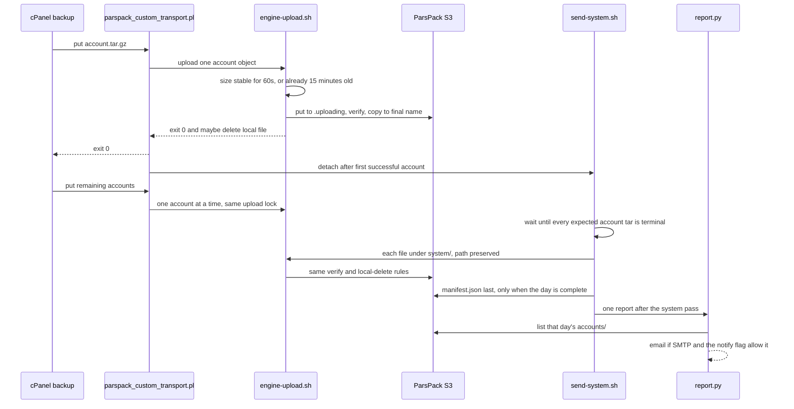

# Architecture

PARSPACK Backup 0.3.0 copies a cPanel backup to an S3-compatible bucket. cPanel’s backup run is the only uploader. This plugin does not install an upload cron. The upload record is `state/parspack.db`. `state/uploads.tsv` is a derived copy for this release.

Install root, fixed: `/root/parspack-backup`. The script cPanel executes is `/usr/local/cpanel/scripts/parspack_custom_transport.pl`, which `install.sh` copies from `transport/parspack_transport.pl`. The WHM page is served from `/usr/local/cpanel/whostmgr/docroot/cgi/parspack_backup/index.php` and calls back into `/root/parspack-backup`.

## One backup night

`put` returns to cPanel before `system/` has been uploaded. The system pass is a second process. It reads `accounts/*.tar.gz` in the local date directory and starts only when every one of those accounts is in a terminal state, or when `SYSTEM_DEADLINE_SECONDS` expires. The report is built from that same pass and uses the database when `state/parspack.db` exists. The rule and its edge cases are in `docs/VERIFICATION.md`.

## Files, commands, locks, state

| Path | Role |
| --- | --- |
| `transport/parspack_transport.pl` | Source of the cPanel transport. Commands: `put`, `get`, `ls`, `mkdir`, `chdir`, `rmdir`, `delete`. |
| `/usr/local/cpanel/scripts/parspack_custom_transport.pl` | The copy cPanel runs. Not updated by editing the source tree alone. |
| `bin/engine-upload.sh` | One local file to one object. Stability, retries, checksum, state transitions, optional local delete. |
| `bin/parspack-state` | SQLite state store. The shell calls this instead of writing the database itself. |
| `bin/remote-ops.sh` | `ls`, `mkdir`, `chdir`, `get`, `delete`, `delete-validation`, `rmdir`. |
| `bin/send-system.sh` | After a successful account `put`, mirror `system/` and then run `report.py`. |
| `bin/send-remaining.sh` | Manual one-pass alias of `retry --date` for the newest day still on disk. |
| `bin/parspackctl` | `doctor`, `connection-test`, `show-config`, `version`, `report`, `send-remaining`, `retry`, `verify`, `status`. |
| `bin/report.py` | Daily HTML report, history JSON, and the deduplicated alert send. |
| `lib/parspack_config.py` | Config validation, remote paths, local path checks, mc config file. |
| `lib/parspack_state.py` | SQLite schema, state machine, 0.2.3 import, crash recovery. |
| `lib/parspack_ui.py` | Read-only dashboard, alert severity, dedupe, and optional channels. |
| `lib/parspack-common.sh` | Bootstrap, logging, mc wrapper, remote-delete gate. |
| `whm/index.php` | WHM UI. Dashboard, reports, and settings. Runs as root. |
| `whm/parspack_backup.conf` | AppConfig registration. `user=root`, `acls=all`. |
| `cron/report.cron` | Commented example only. `install.sh` does not install it. |
| `config/parspack.conf` | Live secrets. Mode `0600`. Not in git. |
| `tests/fake-mc.py` | Offline mc used by `tests/run-tests.sh`. |
| `tests/run-tests.sh` | Root-only offline tests. Disables the age wait. |
| `tests/cpanel-invoke.sh` | Phase 0 skeleton for invoking the transport. Not called by cPanel. |

| Lock or state | What it guards |
| --- | --- |
| `run/upload.lock` | `flock -w` inside `engine-upload.sh`, one file at a time. Default wait 120 seconds. |
| `state/send-system.lock` | One system mirror per host. |
| `state/send-remaining.lock` | One manual pass. |
| `state/parspack.db` | Source of truth for one file's upload state. Mode `0600`, WAL. |
| `state/uploads.tsv` | Derived export of successful rows. The 0.2.3 original is kept as `uploads.tsv.0.2.3.bak`. |
| `state/send-remaining.status` | Manual pass progress for the WHM page. |
| `state/whm-csrf` | WHM form token. Mode `0600`. |
| `state/audit.log` | Settings changes: time, user, key names. Mode `0600`. |
| `state/alert-dedupe.json` | Recent alert fingerprints. Mode `0600`. |
| `state/whm-rate.json` | Recent WHM action times. Mode `0600`. |
| `state/whm-flash.json` | One-shot UI message. |
| `state/history/YYYY-MM-DD.json` | Report snapshot. |
| `reports/YYYY-MM-DD.html` | Report body. |
| `logs/backup.log` | Engine log. |
| `logs/send-system.log` | Detached system mirror. |
| `logs/send-remaining.log` | Manual pass. |
| `logs/transport-trace.log` | Only when `TRANSPORT_TRACE=1`. Password value is not written. |
| `mc-config/config.json` | S3 keys for `mc`. Mode `0600`. |

Remote layout used on the live server: `parspack/<bucket>/cpanel/YYYY-MM-DD/accounts/<user>.tar.gz` and `.../system/dirs/...` plus `.../system/files/...`. The date comes from the backup path, not from the server clock.
